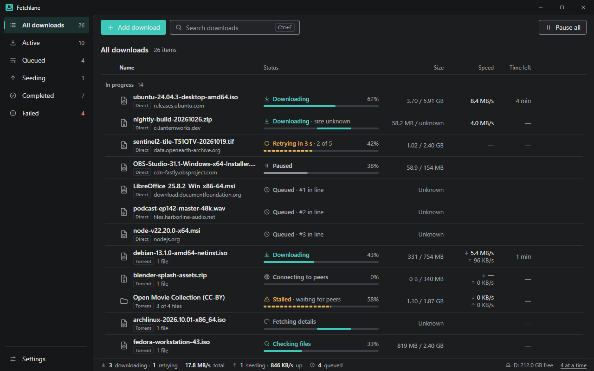
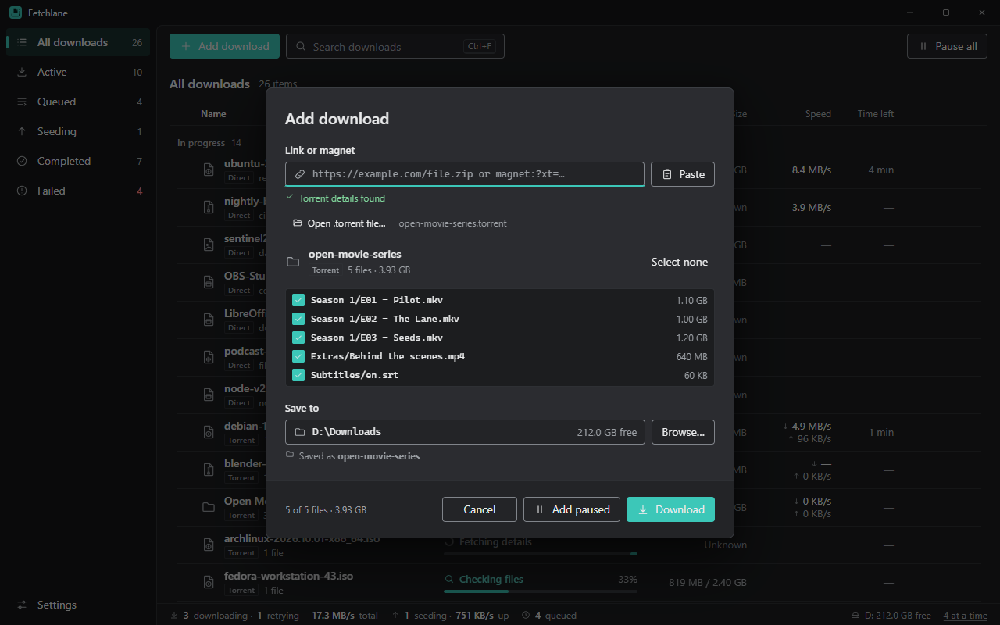

<p align="center"></p>

<h1 align="center">Fetchlane</h1>

<p align="center"><strong>An Open-Source Download Manager for Windows</strong></p>

<p align="center"><em>Your downloads, in order. Direct downloads and BitTorrent in one calm list, with files that arrive intact even after dropped connections, pauses, crashes and misbehaving servers.</em></p>

<div align="center">

[](https://github.com/jrulloda14/Fetchlane/releases/latest)
[](LICENSE)
[](docs/INSTALL.md#windows-10-and-11)
[](https://github.com/jrulloda14/Fetchlane/actions/workflows/windows-ci.yml)

[](docs/INSTALL.md#browser-extension-chrome-edge-brave)

[](https://tauri.app)
[](https://www.rust-lang.org)
[](https://www.typescriptlang.org)
[](docs/USER_GUIDE.md)
[](https://buymeacoffee.com/longitude)

</div>

**Fetchlane** is a free, open-source desktop download manager. Paste a link, a magnet link or a .torrent file, or send downloads from your browser, and Fetchlane keeps them in order: queued, resumed safely, retried when the connection drops, and never overwriting a file you already have.

**Welcome to the v0.1.0 preview!** Windows 10 and 11 are ready to try. Feedback shapes what comes next.

<p align="center"></p>

## What it does

- **Download anything in one list.** Direct http/https links and BitTorrent (magnet links and .torrent files) side by side, each with a quiet Direct or Torrent tag, live progress, speed and time left.
- **Resume safely.** Fetchlane only continues a partial file when the server proves it's the same file. If it can't, it says so and keeps your data until you decide. Crashes and restarts pick up from the last confirmed byte.
- **Ride out bad connections.** Automatic retries with a visible countdown ("Retrying in 8 s · 2 of 5"), optional multi-connection downloads, and plain-language errors that say what to do next.
- **Keep a queue.** Choose how many downloads run at once, reorder by dragging, **Start now** to skip the line, or **Pause all**.
- **Torrents done right.** See a torrent's contents before downloading and pick the files you want. Fetching magnet details can be cancelled, stalled torrents say they're waiting for peers, progress is saved between runs, and seeding stops at the ratio or time you set.
- **Send downloads from your browser.** The extension for Chrome, Edge and Brave hands your downloads to Fetchlane, and **Download with Fetchlane** sits on the right-click menu. You always confirm the folder in Fetchlane.
- **Know when it's done.** A notification from Fetchlane with the name, size and folder, plus **Open** and **Show in folder** buttons.
- **Delete only on purpose.** **Stop seeding**, **Remove from list** and **Delete downloaded files** are separate actions, and deleting shows exactly which files go to the Recycle Bin.

**Private by design:** no account, no sign-up and no telemetry. Fetchlane only connects to the servers and peers of the downloads you add.

## Download

Get the latest version from the **[Releases page](https://github.com/jrulloda14/Fetchlane/releases/latest)**.

| Platform | File | Notes |
| --- | --- | --- |
| Windows 10 / 11 (64-bit) | `Fetchlane_<version>_x64-setup.exe` | Installs for your user account; no admin rights needed. Includes the browser extension. |

Fetchlane isn't code-signed yet, so Windows will show a warning the first time you open it. The **[installation guide](docs/INSTALL.md)** walks through it step by step, including the browser extension.

## Using Fetchlane

1. **Add a download.** Click **Add download** (<kbd>Ctrl</kbd>+<kbd>N</kbd>) or just press <kbd>Ctrl</kbd>+<kbd>V</kbd> with a link on the clipboard. Fetchlane checks the name and size first.
2. **Add a torrent.** Paste a magnet link, choose **Open .torrent file…**, or drop a .torrent file on the window. Pick the files you want and the folder, then **Download**.
3. **Let it run.** Pause, resume, reorder or start downloads right away from the row, its menu or the keyboard. Open **Details** (<kbd>Enter</kbd>) for peers, share ratio, files and **Recheck files**.
4. **Connect your browser.** In **Settings → Browser**, choose **Show extension folder** and load it in Chrome, Edge or Brave.

<p align="center"></p>

The **[user guide](docs/USER_GUIDE.md)** covers statuses, torrents and seeding, the browser extension, notifications, settings and every keyboard shortcut.

## Build from source

Requires Node.js 24, npm 11 and stable Rust (1.90 or newer), plus the [Tauri 2 prerequisites](https://v2.tauri.app/start/prerequisites/) for Windows.

```bash
npm ci
npm run desktop:dev      # run the desktop app in development
npm run desktop:build    # build the installer
npm test                 # UI tests
cargo test --workspace   # engine, torrent and app tests
```

See [CONTRIBUTING.md](CONTRIBUTING.md) for project conventions, [docs/BUILD_AND_RELEASE.md](docs/BUILD_AND_RELEASE.md) for packaging, and [docs/ARCHITECTURE.md](docs/ARCHITECTURE.md) for how it works inside.

## Project status

Fetchlane is an early preview (v0.x). Windows is the tested platform. Known limitations and what has been verified live on the [project status page](docs/PROJECT_STATUS.md), changes in the [changelog](CHANGELOG.md), and what's next on the [roadmap](ROADMAP.md).

Built with [Tauri 2](https://tauri.app), Rust and TypeScript. Torrents use [librqbit](https://github.com/ikatson/rqbit). Fetchlane is written from scratch and isn't affiliated with any commercial download manager.

| Document | What's in it |
| --- | --- |
| [Installation guide](docs/INSTALL.md) | Installing, first launch, the browser extension, updating and uninstalling |
| [User guide](docs/USER_GUIDE.md) | Adding downloads, statuses, torrents, browser, notifications, settings, shortcuts |
| [Architecture](docs/ARCHITECTURE.md) | Code layout, correctness model, torrents, notifications, where data lives |
| [IPC contract](docs/IPC.md) | Commands and events between the UI and the backend, native messaging |
| [Testing](docs/TESTING.md) | Test suites and manual release checks |
| [Build and release](docs/BUILD_AND_RELEASE.md) | Prerequisites, checks, installer, releasing |
| [Design system](assets/fetchlane/design-system/README.md) | Brand, tokens, states, layout and interaction rules |
| [Security policy](SECURITY.md) | What Fetchlane can touch, and how to report a vulnerability |

## Support

Fetchlane is free and open source. If it saves you a broken download or two, you can [buy me a coffee](https://buymeacoffee.com/longitude) ☕. Feedback and bug reports help just as much.

## License

[MIT](LICENSE) © 2026 Fetchlane contributors. Third-party notices are in [THIRD_PARTY_NOTICES.md](THIRD_PARTY_NOTICES.md). The Fetchlane mark, icons and design system in `assets/fetchlane/` belong to the Fetchlane project.
