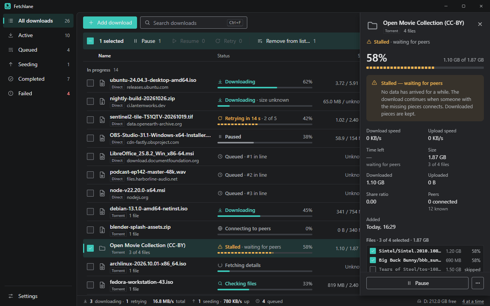
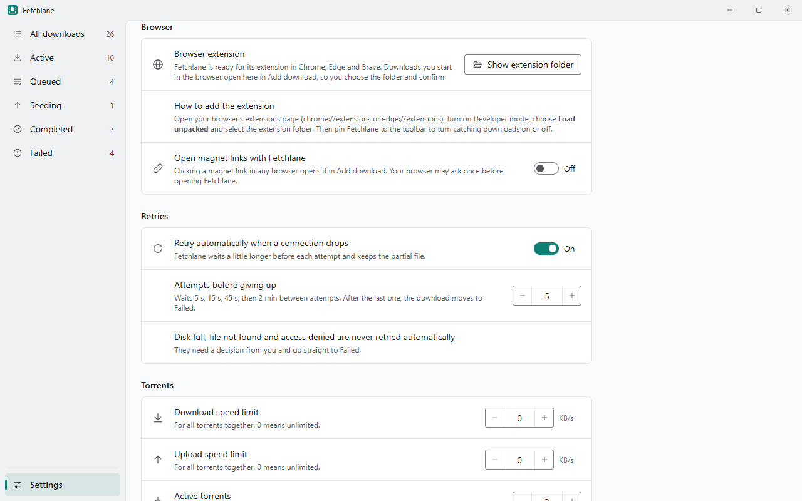

# Fetchlane user guide

Fetchlane keeps your downloads in one list: direct downloads (http and https links) and torrents (magnet links and .torrent files). Each row shows a quiet **Direct** or **Torrent** tag, its progress, speed and time left.

## Adding a download

Click **Add download** (<kbd>Ctrl</kbd>+<kbd>N</kbd>), or press <kbd>Ctrl</kbd>+<kbd>V</kbd> anywhere outside a text field to paste a link straight into it.

- **A link (http or https).** Fetchlane checks it with the server and shows the file name, size and whether the download can be resumed. If a file with that name is already in the folder, it suggests a numbered name instead of overwriting anything.
  - **Download** starts it now, or puts it first in line if all slots are busy.
  - **Add to queue** puts it last in line.
- **A link to a .torrent file** opens the torrent's contents instead of saving the .torrent file.
- **A magnet link.** Fetchlane shows **Fetching torrent details** while it asks other people for the torrent's file list. This can take a minute; **Cancel fetching** stops it. Tick **Start automatically after fetching details** (off by default) to have it start with every file as soon as the details arrive.
- **A .torrent file.** Click **Open .torrent file…** or drop the file on the window.

For torrents you see the contents first: tick the files you want, check the total and the folder, then choose **Download** or **Add paused**.

**Save to** shows the free space on that drive. **Browse…** picks another folder. With **Ask where to save each download** on (Settings), the folder comes first.

## Lists and statuses

The sidebar filters the list: **All downloads**, **Active**, **Queued**, **Seeding**, **Completed** and **Failed**. Every status shows an icon and words, never colour alone.

| Status | What it means |
| --- | --- |
| Downloading | Data is arriving. |
| Queued · #2 in line | Waiting for a free slot. |
| Paused | Stopped by you; partial data is kept. |
| Retrying in 8 s · 2 of 5 | The connection dropped; Fetchlane tries again by itself. |
| Failed · reason | Needs you: the row shows the recovery action (Retry, Restart, Recheck files). |
| Failed · Can't resume | The partial file can't be continued (the server can't resume, the file changed, or its ranges weren't reliable). The partial data is kept until you choose **Restart download…**, which says how much it discards and asks first. |
| Completed | Done. Press <kbd>Enter</kbd> to open the file. |
| Fetching details | A magnet link is getting its file list. |
| Checking files | A torrent is verifying data already on disk. |
| Connecting to peers | A torrent is looking for people to download from. |
| Stalled · waiting for peers | Nobody is sending data right now; downloaded pieces are kept. |
| Seeding | Complete, and uploading to other people. |
| Completed · not seeding | Complete, and seeding is stopped. |

The status bar shows how many downloads are running, the total download speed, how many torrents are seeding and the upload speed.

## Working with downloads

Hover a row for its main actions, or use **⋯** / right-click for everything else.

- **Pause** keeps the partial file. If the server can't resume, Pause is unavailable and the menu says why.
- **Cancel…** stops a direct download and deletes its partial file. The entry stays as Cancelled.
- **Restart download…** deletes partial data and starts from zero. It always asks first and says how much would be lost.
- **Start now** runs a queued download even if every slot is busy. **Move to top / up / down** (or drag the grip in the Queued list) changes the order.
- **Pause all / Resume all** affects everything; Pause all also holds the queue.
- **Copy link** copies the full link. Links are shown without passwords or query parameters until you click the eye button.
- Select several rows (click, <kbd>Ctrl</kbd>+click, <kbd>Shift</kbd>+click) and the toolbar shows what each action applies to, such as "Pause 2".

## Torrents

Open a torrent's details (<kbd>Enter</kbd> or <kbd>Ctrl</kbd>+<kbd>I</kbd>) to see its files and selection, peers, downloaded and uploaded totals, share ratio, seeding status and limits, and trackers.

- **Files:** tick or untick files to download or skip them at any time.
- **Recheck files** verifies every piece on disk and downloads anything missing or damaged.
- Progress is saved. After a restart, Fetchlane spot-checks the data instead of reading all of it again.
- **Seeding** shares the pieces you have with other people downloading the same torrent. It continues after your download completes, until a limit in Settings is reached or you choose **Stop seeding**. **Start seeding** resumes it and ignores the automatic limits until you stop it again.

Three different actions, three different results:

| Action | List entry | Files on disk |
| --- | --- | --- |
| **Stop seeding** | Kept | Kept |
| **Remove from list…** | Removed | Kept |
| **Delete downloaded files…** | Removed | Sent to the Recycle Bin |

**Delete downloaded files…** always asks first and shows exactly what goes: how many files, how much data, which folder and a few file names. Only the files that belong to that download are deleted; anything else in the folder is kept.

## From your browser

With the [browser extension](INSTALL.md#browser-extension-chrome-edge-brave) installed:

- Right-click a link (including magnet links), video, audio file or image and choose **Download with Fetchlane**. Fetchlane opens **Add download**, so you still choose the folder and confirm.
- **Catch browser downloads** is off by default. Turn it on in the extension's popup to have downloads you start in Chrome, Edge or Brave open in Fetchlane instead. The popup can also turn catching off for the current site and leave small files to the browser.

What catching can and can't do:

- The browser stops its own download and hands **only the link** to Fetchlane. Your sign-in, cookies, form data and one-time tokens don't go with it, so downloads that need them can fail in Fetchlane. Turn catching off for those sites.
- If you choose **Cancel** in Add download, nothing is downloaded: the browser's copy was already stopped. Start the download in the browser again.
- If Fetchlane can't be reached, the extension asks the browser to download the link again. That's a new request, so it can fail for links that only work once.

Links also reach Fetchlane from Windows: magnet links (if you turn that on in Settings), .torrent files opened with Fetchlane, and `fetchlane.exe --add <link>`. If several arrive at once, they wait and open one after another.

## Notifications

When a download finishes, Fetchlane shows a Windows notification with the name, size and folder. **Open** opens the file, **Show in folder** selects it in Explorer, and clicking the notification brings Fetchlane forward with that download selected. Several downloads finishing together are summed up in one notification. Turn them off in **Settings → Downloads → Notify when a download finishes**.

## Settings

Changes apply right away.

- **Downloads:** default folder, ask where to save each download, simultaneous downloads (1–10), connections per download (1–8), continue unfinished downloads when Fetchlane starts, notifications.
- **Browser:** extension status and folder, open magnet links with Fetchlane.
- **Retries:** retry automatically and how many attempts. Disk full, file not found and access denied are never retried automatically.
- **Torrents:** download and upload speed limits, active torrents (1–20), stop seeding at a share ratio or after a time.
- **Appearance:** theme (System, Light, Dark) and list density (Comfortable, Compact).
- **History:** keep completed entries after a restart, or clear them (files stay on disk).

## Keyboard shortcuts

| Keys | Action |
| --- | --- |
| <kbd>Ctrl</kbd>+<kbd>N</kbd> | Add download |
| <kbd>Ctrl</kbd>+<kbd>V</kbd> | Add download with the link on the clipboard (outside text fields) |
| <kbd>Ctrl</kbd>+<kbd>F</kbd> | Search |
| <kbd>Ctrl</kbd>+<kbd>I</kbd> | Details of the focused download |
| <kbd>↑</kbd> <kbd>↓</kbd> <kbd>Home</kbd> <kbd>End</kbd> | Move through the list (<kbd>Shift</kbd> extends the selection) |
| <kbd>Space</kbd> | Select or unselect |
| <kbd>Ctrl</kbd>+<kbd>A</kbd> | Select the whole list |
| <kbd>Enter</kbd> | Open details, or open the file when it's complete |
| <kbd>Delete</kbd> | Remove from list (asks first) |
| <kbd>Alt</kbd>+<kbd>↑</kbd> / <kbd>Alt</kbd>+<kbd>↓</kbd> | Move a queued download up or down |
| <kbd>Shift</kbd>+<kbd>F10</kbd> or <kbd>Menu</kbd> | Row menu |
| <kbd>Esc</kbd> | Clear the selection, then close details |
